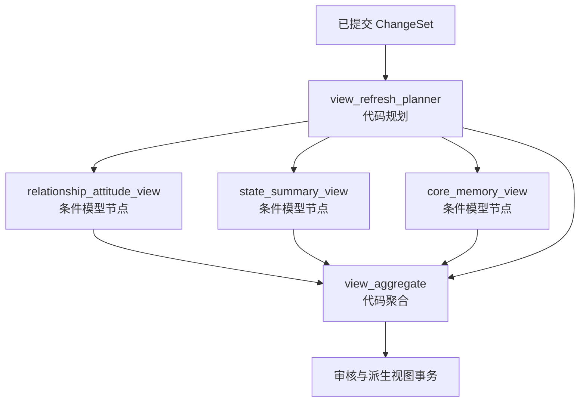

# view_refresh：把已保存事实整理成易读认识

## 1. 输入及用途

本图读取已经提交的 ChangeSet（事实变化集合），按需要更新关系态度、自身状态摘要和核心记忆视图。输入来自正式关系、状态和长期记忆事实；模型不能通过刷新新增关系证据、改变分数或创建没有来源的经历。

ChangeSet 明确社群、角色、事实种类、具体记录及源版本。正式提交后记录变化，后台合并尚未处理的变化并冻结当前有效事实，按材料预算创建批次。关系分支每批处理一个目标，其余目标保留待处理；同一角色已有运行时继续积累。没有变化、未读核心页面、首次描述遗漏或明确重建请求时不调用模型，不设置第三套时间循环。

## 2. 五节点拓扑

| 节点 | 输入与条件 | 输出 |
|---|---|---|
| view_refresh_planner | change_set.v1；读取正式变化及当前视图版本 | 目标视图、事实引用、源版本与刷新请求 |
| relationship_attitude_view | view_refresh_request.v1；存在被选中的关系变化 | relationship_attitude 文字及证据 |
| state_summary_view | 存在被选中的状态变化 | state_summary 文字及证据 |
| core_memory_view | 长期页变化、未读页面或明确重建请求 | core_memory 文字、supporting_memory_ids 及证据 |
| view_aggregate | reflection_artifacts.v1；规划及已解决分支 | ViewRewriteCandidate、CoreMemoryRewriteCandidate 或 NoOp |

未选分支 skipped；条件分支可以给出明确 NoOp。代码规划器不调用模型，不能根据未提交候选安排刷新。

## 3. 视图内容及审核

ViewRefreshAction 包括 view_kind、content、supporting_memory_ids、evidence_refs，以及关系态度的 target。状态摘要正文最多 3000 字符；关系态度使用 `reflection.relationship_attitude_max_chars`，默认 300，范围 1～3000；核心记忆使用 `reflection.core_memory_max_chars`，默认 600，范围 1～6000。支持记忆引用最多 64 项。关系态度表达对明确目标的认识；状态摘要归纳当前有效状态；核心记忆保留重要经历与未完成约定。来源与读取记录见 [记忆设计](../memory.md#核心视图的依据与读取记录)。

每个视图绑定 source_snapshot_version、生成版本、正式事实引用及时间。关系目标属于实际变化范围；核心记忆引用必须属于本实例且仍然有效。审核重新读取源版本，变化后拒绝旧刷新候选，避免旧摘要覆盖新认识。

视图正文使用角色第一人称，表达已保存事实所支持的认识。关系态度不新增证据或增加分数；状态摘要不创造未记录的情绪或身体情况；核心记忆不把他人陈述变成自身确定的亲身经历。关系目标按多角色身份区分。共同表达规则与固定正文见 [反思提示契约](../character-prompt-contracts.md#5-共同反思输出规则)。各分支使用专属情境提示。核心记忆和状态摘要进入完整模式的聊天输入；读取时排除来源已失效的视图。

### 3.1 关系描述

关系描述回答角色目前怎样看待一个具体的人。陌生人没有数值和共同经历描述，聊天只说明“目前还不熟，没有具体相处印象”。第一次实际互动按现有 50/50/0 基准及证据计算数值，并在同一事务记录待刷新变化。之后每次新增关系证据都记录变化，中性证据也能更新认识；数值版本仍只随实际数值或关系类型变化递增。

每个关系分支只处理一个目标。输入冻结目标身份、观察者和目标自然称呼、状态版本、截止时间内证据数量、已有描述及 `initial_description`。证据提供正式身份、类别、来源、发生时间、正文读取状态。段摘要可能包含多人，`target_messages` 额外提供该来源中由当前目标实际发出的可见消息。人物正文与 voice 提供表达，其他人的经历不能移到当前目标身上。

有证据记录但正文不可读取时，标记 `content_status=unavailable`，允许形成有限的当前认识；不补写互动。真正没有证据的已初始化关系记录 `relationship_evidence_missing`，不调用模型编造描述。材料预算无法放入任何已有证据时返回预算冲突。

首次描述且有证据时必须生成正文；已有描述没有新的认识时允许 `no_op` 保留旧内容。正文通常 80～180 字符，`reflection.relationship_attitude_max_chars` 默认 300，范围 1～3000。提示、节点和整图审核使用相同上限，超长或首次错误返回 `no_op` 使用现有有限修正与重试。固定提示见 [relationship_attitude_view](../../../src/echo_commons/resources/prompts/reflection/nodes/relationship_attitude_view.md)。

保存前校验批次版本、目标正式状态和证据版本，并检查引用证据属于当前目标及冻结截止时间。来源变化使旧批次失效，保留原输入和结果，再准备新材料。保存态度只更新正文、引用和记录时间，不重新计算数值或增加数值状态版本。

### 3.2 目标进度与恢复

`memory_relationship_refreshes` 把目标、实际来源版本、请求类型和图运行关联到现有变化批次。来源版本由正式状态版本与冻结证据数量组成；没有新增证据时，遗漏修复只安排一次。已有正常待处理变化直接使用原变化，避免重复安排遗漏修复。真正缺少证据也保留一次诊断。

调度不再因任意旧部分成功图而阻止整个角色刷新。失败目标保留记录，其他未分配目标继续处理；新证据形成新来源版本，可以再次刷新。耗尽后通过原图的重试或补充图入口恢复，补充图复用成功分支，并把目标进度关联到实际恢复运行。已有非空描述继续使用，正常的新证据或明确手动请求才触发更新。

管理端 `POST /internal/communities/{community_id}/characters/{character_id}/reflection/relationship-attitudes` 接受 UUID `request_id` 和可选 `target={kind,actor_id}`。提供目标时只刷新该目标，省略时分别安排全部已初始化目标；陌生人不参加。每个目标有独立批次和图运行，缺少证据的目标返回诊断，不影响其他目标。重复请求复用同一组运行，改变请求范围返回冲突。手动请求重新冻结当前事实，不修改已消费批次的历史材料。

管理关系查询返回自然称呼和每个目标最近的运行状态、来源版本、请求类型、错误类型；界面提供单个与全部重新整理，以及现有运行详情中的恢复操作。用户响应不暴露内部错误。

## 4. 事务、失败和重建

获准的 state_summary 与 core_memory 保存到 memory_views；relationship_attitude 属于明确目标的 relationship_state 态度字段及来源引用。刷新保存与图结果处于同一事务。视图可从正式事实重建，删除视图不删除其事实依据。重复源版本与视图种类不能产生冲突版本。

一个可选分支失败时，其他合法视图可按 partial 规则提交；已经保存的权威关系、状态和记忆事实保持有效。视图失败不回滚此前另一事务中的事实。恢复需要保留成功产物并明确处理尚未刷新目标，见 [共同执行模型](execution-model.md)。

## 5. 运行例子与当前状态

甲对 Alice 的信任增加，并保存一个“下周带棋盘”的长期记忆页。正式事实事务完成后产生 ChangeSet。规划器选择关系态度及核心记忆分支，没有状态变化便跳过状态分支。两个视图形成“我更愿意听她的意见”和带实际记忆引用的近期重点。乙的视图不会随甲变化。

正式事实提交、变化批次、条件规划、模型分支、审核与视图保存使用同一执行体系。源版本变化时废弃旧批次并重新准备当前事实；部分成功通过补充运行完成失败分支。关系态度不改变关系数值。

每个关系事实同时冻结该目标最近最多八条已记录证据，包含类别、来源、发生时间及可读取的正文。消息正文按共同成员区间和受众规则检查；对话段使用本角色已经审核保存的摘要，并检查其消息可见性。证据与正式事实共同受材料字符预算限制，部分证据无法容纳时不加入输入；全部证据均无法容纳时返回预算冲突，不能把它解释为证据不存在。态度保存本次实际提供的证据编号。旧冻结批次没有证据列表时，沿用观察时间之前的证据引用规则，不重新拼装旧输入。

## 6. 核心分支选材、预算与重建

核心记忆保存现在仍需记住的重要经历、未完成约定、已确认的长期打算和有依据的认识。性格与表达习惯由人物正文负责；普通喜好和作息保留在长期页，按话题检索；对具体人物的完整态度由关系描述负责。

正文使用角色第一人称，作者确认的过去与实际互动都可以成为依据。共同写作和聊天使用规则见 [提示契约](../character-prompt-contracts.md)。固定提示见 [core_memory_view](../../../src/echo_commons/resources/prompts/reflection/nodes/core_memory_view.md)。该节点读取人物正文和 voice；voice 决定措辞，事实仍由页面提供。

页面、支持材料及范围说明共用 `reflection.max_materials` 和 `reflection.max_material_chars`。只有核心分支实际成功提交或明确返回 `no_op`，才记录成功读取进度。未读页面通过已有认识刷新调度继续处理；新版本页面重新进入未读范围。旧依据页继续参与，保留仍重要的经历。

同时存在状态或关系变化时，它们可以先使用预算；核心页面无法容纳时，保留其待处理变化供下一批读取。单独核心任务仍无法容纳旧依据页或任何未读页时，返回预算冲突，调整预算后重新安排。调度不能反复调用模型而完全没有读取新页面。

`reflection.core_memory_max_chars` 默认 600，范围 1～6000。提示词、输出协议检查、节点审核及最终图审核共用配置。正文通常为 200～400 字符，完整事实优先，不设最低长度。超长内容进入现有有限修正流程，要求模型合并重复表达；程序不截取字符串。

保存前重新检查页面及完整候选集合的版本；页面新增、失效或变更时，旧结果失效，按正式恢复流程重新准备来源。`no_op` 表示已读取候选没有值得常驻的内容。只有全部有效候选已成功读取、来源完整且审核通过，才清除旧核心视图。输入不完整、来源缺失、模型或审核失败时保留旧正文。清除视图不删除长期页。已有正文不自动改写，手动重建或新的正式记忆变化触发刷新。

管理端通过 `POST /internal/communities/{community_id}/characters/{character_id}/reflection/core-memory` 安排正式 `view_refresh`，正文包含 UUID `request_id`。重复请求返回同一运行，网络重试不会重复安排。该入口要求完整记忆模式，重新读取当前候选，不改写已消费变化或旧冻结输入。

同路径 `GET` 返回当前正文、依据引用、配置上限、最近运行、重建前正文、所选和未读页面、读取状态及内部错误类型。页面并列展示前后正文，运行详情展示冻结材料、候选、审核及真实模型调用量。玩家页面使用友好提示。

查询由记忆管理模块负责，安排任务由反思运行模块负责，接口层负责字段转换。视图、读取进度和图级审核在同一事务中提交；模型调用期间不持有写事务。

`ViewScheduling` 统一安排自动刷新与手动核心重建。图提交将实际视图分支结果作为 `ViewBranchResult` 传给记忆写入服务；核心分支读取进度只随该分支成功提交更新，其他分支保持各自的提交规则。冻结批次保留既有格式与迁移记录，程序版本和候选范围不作为模型事实材料。
