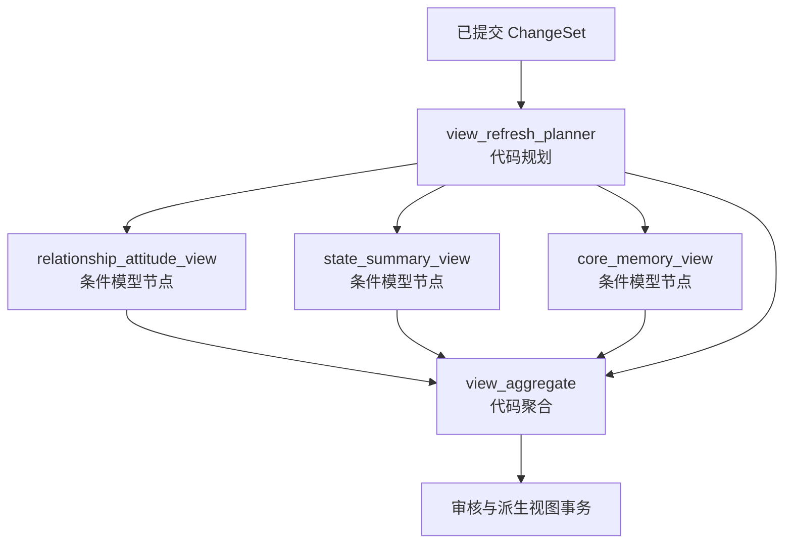

# view_refresh：把已保存事实整理成易读认识

## 1. 输入及用途

本图读取已经提交的 ChangeSet（事实变化集合），按需要更新关系态度、自身状态摘要和核心记忆视图。输入来自正式关系、状态和长期记忆事实；模型不能通过刷新新增关系证据、改变分数或创建没有来源的经历。

ChangeSet 明确社群、角色、事实种类、具体记录及源版本。正式提交后记录变化，后台合并尚未处理的变化并冻结当前有效事实，按材料预算创建批次。关系分支每批处理一个目标，其余目标保留待处理；同一角色已有运行时继续积累。没有变化便不调用模型，不设置第三套时间循环。

## 2. 五节点拓扑

| 节点 | 输入与条件 | 输出 |
|---|---|---|
| view_refresh_planner | change_set.v1；读取正式变化及当前视图版本 | 目标视图、事实引用、源版本与刷新请求 |
| relationship_attitude_view | view_refresh_request.v1；存在被选中的关系变化 | relationship_attitude 文字及证据 |
| state_summary_view | 存在被选中的状态变化 | state_summary 文字及证据 |
| core_memory_view | 存在被选中的长期记忆变化 | core_memory 文字、supporting_memory_ids 及证据 |
| view_aggregate | reflection_artifacts.v1；规划及已解决分支 | ViewRewriteCandidate、CoreMemoryRewriteCandidate 或 NoOp |

未选分支 skipped；条件分支可以给出明确 NoOp。代码规划器不调用模型，不能根据未提交候选安排刷新。

## 3. 视图内容及审核

ViewRefreshAction 包括 view_kind、content、supporting_memory_ids、evidence_refs，以及关系态度的 target。状态摘要和关系态度正文最多 3000 字符，核心记忆最多 6000 字符，支持记忆引用最多 64 项。关系态度表达对明确目标的认识；状态摘要归纳当前有效自身状态；核心记忆选出有实际来源的重要记忆，不新增事实。

每个视图绑定 source_snapshot_version、生成版本、正式事实引用及时间。关系目标属于实际变化范围；核心记忆引用必须属于本实例且仍然有效。审核重新读取源版本，变化后拒绝旧刷新候选，避免旧摘要覆盖新认识。

视图正文使用角色第一人称，表达已保存事实所支持的认识。关系态度不新增证据或增加分数；状态摘要不创造未记录的情绪或身体情况；核心记忆不把他人陈述变成自身确定的亲身经历。关系目标按多角色身份区分。共同表达规则与固定正文见 [反思提示契约](../character-prompt-contracts.md#5-共同反思输出规则)。各分支使用专属情境提示。核心记忆和状态摘要进入完整模式的聊天输入；读取时排除来源已失效的视图。

## 4. 事务、失败和重建

获准的 state_summary 与 core_memory 保存到 memory_views；relationship_attitude 属于明确目标的 relationship_state 态度字段及来源引用。刷新保存与图结果处于同一事务。视图可从正式事实重建，删除视图不删除其事实依据。重复源版本与视图种类不能产生冲突版本。

一个可选分支失败时，其他合法视图可按 partial 规则提交；已经保存的权威关系、状态和记忆事实保持有效。视图失败不回滚此前另一事务中的事实。恢复需要保留成功产物并明确处理尚未刷新目标，见 [共同执行模型](execution-model.md)。

## 5. 运行例子与当前状态

甲对 Alice 的信任增加，并保存一个“下周带棋盘”的长期记忆页。正式事实事务完成后产生 ChangeSet。规划器选择关系态度及核心记忆分支，没有状态变化便跳过状态分支。两个视图形成“我更愿意听她的意见”和带实际记忆引用的近期重点。乙的视图不会随甲变化。

正式事实提交、变化批次、条件规划、模型分支、审核与视图保存使用同一执行体系。源版本变化时废弃旧批次并重新准备当前事实；部分成功通过补充运行完成失败分支。关系态度不改变关系数值。

每个关系事实同时冻结该目标最近最多八条已记录证据，包含类别、来源、发生时间及可读取的正文。消息正文按共同成员区间和受众规则检查；对话段使用本角色已经审核保存的摘要，并检查其消息可见性。证据与正式事实共同受材料字符预算限制，无法容纳的证据不加入输入，不能补写正文。态度保存本次实际提供的证据编号。旧冻结批次没有证据列表时，沿用观察时间之前的证据引用规则，不重新拼装旧输入。
