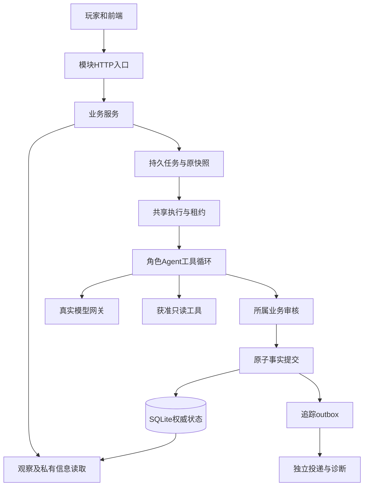

# 系统架构与运行模型

版本：0.1.0。本文及本目录是待审核的设计说明，定义多角色社群平台的模块职责、业务规则及运行流程。当前代码的实现状态单独见 [能力与差异](../status.md)。

## 1. 平台管理什么

平台为社群中的真人玩家与独立角色智能体提供交流和共享活动的基础。真人通过接口输入，角色根据自己的身份、观察和记忆提出行动，后端检查并保存权威事实。前端展示已经提交的事实和实际执行状态。

当前基础范围包含社群、玩家、人物模板、角色实例、群聊与独立私聊会话、会话消息、多角色回应、记忆检索与三个已接入反思图。生活模拟、模型参与意愿、角色主动连续聊天和活动玩法属于后续能力。目标反思体系包含四种图，认识刷新尚未接入；日记暂缓，既有定义和存储不代表可运行能力。

运行目标是本地单进程服务与 SQLite。多个模型请求可以并发，数据库写入使用短事务。HTTP 里的 player_id 选择本地玩家身份并检查成员资格；用户登录、公网授权和分布式执行需要自己的明确产品需求。

## 2. 对象和责任

| 对象 | 业务意义 | 归属 |
|---|---|---|
| Community | 世界范围、成员、世界时间与运行状态 | communities |
| Player | 实际真人身份，可以参加多个社群 | communities |
| CharacterBlueprint | 作者定义的人格、声音、能力与初始记忆 | characters |
| CharacterInstance | 模板在某个社群中的独立人物 | characters |
| Conversation / Membership | 交流空间与一次加入的历史区间 | conversations |
| Message / InputBatch | 一次权威发言与同主体同受众的一批输入 | conversations |
| SocialTurn / ParticipationDecision | 一组来源的回应安排及每个角色的选择和结果 | social |
| ConversationTask | 某角色对某轮次的一次逻辑生成任务 | conversations |
| ContextSnapshot | 本次调用固定使用的世界、自身与记忆输入 | 具体任务模块 |
| MemorySegment / SummaryBatch | 精确经历材料与冻结摘要来源 | memory |
| ReflectionGraphRun | 根据固定拓扑处理来源并提出长期变化 | reflection |
| Activity / ActivityTask | 未来共享玩法与独立行动任务 | 未来 activities |

实例身份、社群归属、成员区间和来源版本都是正式业务身份。显示名称与模板名称可以相同，不能替代这些标识。一个角色的关系和记忆不会自动成为另一角色的认识。

不同对象独立保存状态、结果和资格。任务 completed、参与决定 completed、轮次 completed 与反思节点 completed 分别表达各自的完成条件。完整归属和实际联动见 [对象生命周期](object-lifecycles.md)。

## 3. 模块依赖与权威写入

app 是组合根，明确构造业务服务和端口。modules 的纯规则、服务、存储和接口分别承担规则计算、业务步骤、持久化和协议转换。agents 提供共同调用协议及工具循环，execution 提供队列分派、租约、额度和关闭，infrastructure 提供数据库、模型及诊断。

跨模块通过明确读取和事实写入端口合作。一次业务事务中的写入共享同一连接。Agent 不能访问 Repository 或修改权威状态。候选生成成功、追踪投递成功与事实提交成功具有不同含义。

## 4. 群聊完整运行

Alice、Bob 和三个角色甲乙丙加入会话。Alice 连续输入两条，Bob 输入一条，各自形成输入批次。最后一次输入后窗口到期，同受众的结束批次进入一个 SocialTurn。选择规则优先提及对象，再按最近发言排序，逐次选择一名角色。

甲先获得任务与自己的冻结输入。甲生成并通过审核后，事务保存回应、非空 Thought、角色批次和后续触发。新的回应安排为乙准备包含甲新发言及根玩家问题的输入；该任务后续重试读取同一快照。沉默或最终失败后尝试其他候选，接话达到消息或任务额度后结束。玩家新输入取消旧链，等待输入窗口结束后建立新链。完整规则见 [会话设计](conversation-and-social.md)。

Alice 与甲交流时创建双方的独立会话，乙与 Bob 的历史、检索和反思均不能获得该会话材料。历史私有消息与已有轮次继续保留原受众。成员离开后重新加入产生新区间，不能取得旧轮次的迟到回应。

## 5. 从经历到长期信息

每个角色分别选择自己的可见消息与自身 Thought，形成精确 MemorySegment。段反思生成摘要，并按条件分析关系和状态。候选通过图级审核后在同一事务更新摘要与角色事实。

连续性压缩读取前一会话摘要及新段摘要，推进历史覆盖。记忆组织使用独立消费记录，将实际经历整理为可检索页与实体图。它们可以消费相同段摘要，分别保留进度。日记与派生视图具有独立设计，不以空结果表示已实现。

## 6. 一致性与失败后续

| 机制 | 保障什么 |
|---|---|
| 明确身份与可见性 | 数据属于谁、谁可以读取 |
| 原快照与版本 | 本次行动根据哪些材料产生 |
| 租约与代次 | 当前由哪个执行者提交 |
| 类型契约与业务审核 | 候选是否符合允许行动和业务条件 |
| 短事务与唯一约束 | 事实完整写入且不重复 |
| 生命周期与恢复 | 暂停、离开、失败和重启后状态可继续解释 |

临时故障按有限预算重试，配置和权限错误明确失败。一个角色失败保留其他角色成功。可选反思分支失败可以形成 partial，必需分支失败不能提交缺少必要内容的图。恢复规则见 [任务执行](task-execution.md) 和 [反思共同模型](reflection/execution-model.md)。

## 7. 活动如何接入

活动保存自己的权威状态、合法动作和行动顺序。角色在 ActivityTask 中提出玩法操作，在 ConversationTask 中提出发言。两者共享身份、观察、记忆及模型额度，各自持有输入、状态版本、结果和提交入口。

飞行棋当前行动者可以操作棋局，其他人仍可聊天。聊天未完成不阻止合法棋局操作，棋局变化也不能使旧操作绕过版本检查。完整流程见 [活动接入](activity-integration.md)。

## 8. 阅读路径

身份和时间见 [身份与社群](identity-and-communities.md)，交流见 [会话与社会轮次](conversation-and-social.md)，信息边界见 [观察与上下文](perspective-and-context.md)，主观变化见 [状态与关系](character-state-and-relationships.md)。长期材料见 [记忆](memory.md)，四图见 [反思索引](reflection/README.md)。协议、运行和已知差异分别在正式参考、指南与状态文档中。
