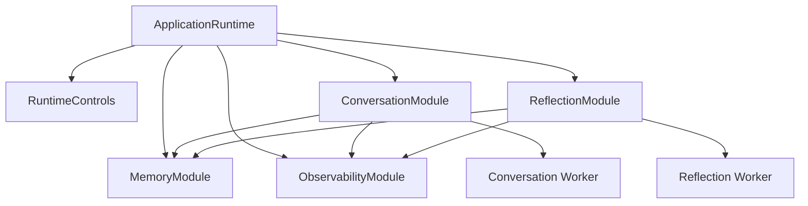

# 应用组合与模块边界

## 职责

`ApplicationRuntime` 是应用组合根。它创建数据库 Repository、共享端口、业务模块、Worker 和生命周期对象，并为 API 保留稳定的调用外观。它不承载某个业务模块的规则。

模块由 `server/src/echo_server/runtime/modules.py` 定义：

| 模块 | 持有的责任 |
|---|---|
| `ConversationModule` | 消息接收、InputBatch、ConversationTask、会话上下文、角色回复审核与提交 |
| `ReflectionModule` | GraphRun、NodeTask、Artifact、图级审核、反思事实提交和反思 Worker 端口 |
| `MemoryModule` | 段、记忆条目、日记、Thought、记忆图和记忆搜索 |
| `ObservabilityModule` | Trace outbox 投递、Trace 查询、运行观察和 `ReflectionRunView` |
| `RuntimeControls` | 数据库、Settings、Agent、时钟、Worker 身份和唤醒状态等共享运行控制 |

`RuntimeControls` 只保存组合层控制信息。它不替代领域对象，也不向业务服务暴露整个应用对象。

## 组合顺序

组合根先创建共享 Repository，再创建四个模块，最后绑定服务之间的端口和 Worker。模块可以在测试中单独构造，测试不需要创建 FastAPI 应用。

## 依赖规则

- `api/` 只依赖 `ApplicationRuntime` 的公开方法和 API DTO。
- 会话服务接收 `ConversationModule`，反思服务接收 `ReflectionModule`，观测服务接收 `ObservabilityModule`。
- 服务不接收 `ApplicationRuntime`，也不接收无类型的 `object` 作为 Runtime 容器。
- 生命周期对象可以接收 `ApplicationRuntime`，因为它负责启动和关闭整个组合。
- Reflection 模块只持有反思所需的消息读取端口、上下文来源、Memory 端口和状态/关系 Repository；它不持有 ConversationTask、InputBatch 或会话执行服务。
- 业务模块之间通过明确的端口和 Repository 访问数据，禁止重新建立第二个组合根。

## 测试入口

- 模块服务测试位于 `server/tests/` 的 conversation、reflection、memory 和 observability 测试文件。
- `ApplicationRuntime` 组合和 Worker 生命周期由 acceptance、T1、T2、T3 测试覆盖。
- 修改模块依赖时，先运行受影响模块测试，再运行完整后端基线。
