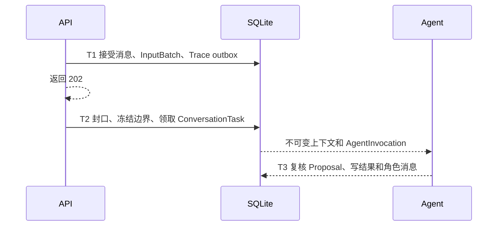

# 持久化与事务边界

## 职责

SQLite 是当前后端唯一权威持久层。`store/` 负责连接、migration、Repository 和记录映射；`domain/` 不依赖 SQLite；Runtime 决定事务顺序。

当前反思运行表由 `0015_reflection_runtime_rebuild.sql` 建立：

- `reflection_graph_runs`：一次图运行的身份、来源范围、拓扑和图级状态；
- `reflection_node_tasks`：节点依赖、领取、租约、尝试次数和节点状态；
- `reflection_artifacts`：一次节点执行的不可变结构化输出；
- `reflection_graph_results`：图级汇聚内容和一次审核决定。

旧反思表由同一份新 migration 在开发数据库中删除。历史 migration 文件保持不可变，运行时代码只访问最终表。

## 会话事务

- T1 处理消息幂等和输入批次。
- T2 选择连续输入前缀，冻结消息范围和上下文边界，建立任务租约。
- Agent、工具和模型调用期间不持有 SQLite 写事务。
- T3 重新读取任务租约、来源和资格，审核 Proposal，写入批准事实，并更新任务和批次状态。

## 反思事务

- 调度事务创建 GraphRun、根 NodeTask 和 Trace outbox。
- NodeTask 领取、租约续期、重试和完成各自使用短事务。
- 节点调用完成后，Artifact 与 NodeTask 状态在短事务中提交。
- 所有必需节点完成后，Runtime 在内存中构造 `ReflectionBatch`，写入图级结果并审核。
- 通过审核的 `SegmentReflectionChangeSet` 在一个短事务中写入摘要、状态和关系事实。
- 事实提交与派生视图刷新分开处理。

## 不变量

- Agent 没有 Repository 和数据库连接。
- 过期租约不能写入结果，也不能激活后继节点。
- 任务身份、来源身份和事实版本由各自领域对象唯一负责。
- 运行数据可以在开发阶段重建；消息、记忆事实、状态事实和关系事实属于独立权威数据。
- Repository 写操作必须接收显式事务连接。

## 测试入口

- migration 和最终反思表：`server/tests/test_reflection_persistence.py`。
- T1/T2/T3 事务：`server/tests/test_runtime_t1.py`、`test_runtime_t2.py`、`test_runtime_t3.py`。
- 图运行恢复与租约：`server/tests/test_reflection_runtime.py`、`test_reflection_graph_runtime.py`。
